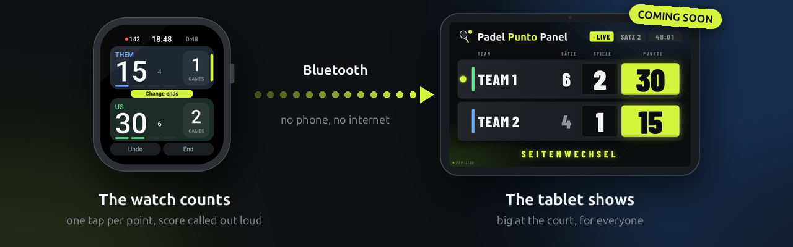

  

  
  
  

<h3 align="center">
  Tap your side, play the next point. 
  Your watch keeps the score – and calls it out loud.
</h3>

 

## Padel Punto for your watch

<table>
  <tr>
    <td width="46%" align="center">
      
      &nbsp;
      
    </td>
    <td valign="top">
      
<b>Available now</b> in the Zepp App Store 
      Amazfit Bip 6 · Active 2 (Square) · Bip Max

      <ul>
        <li><b>One tap per point</b> on big team cards, readable in bright sun</li>
        <li><b>The score out loud</b> after every point, offline</li>
        <li><b>Your rules:</b> Advantage, Golden Point or Star Point, short sets, match tiebreak</li>
        <li><b>On its own:</b> no phone, no internet, no account</li>
      </ul>
      
<b>Get it:</b> Zepp app → your watch → App Store 
      <a href="https://github.com/PadelPunto/watch-zepp">All features and the code →</a>

    </td>
  </tr>
</table>

## Padel Punto Panel for the tablet

<table>
  <tr>
    <td width="46%" align="center">
      
    </td>
    <td valign="top">
      
<b>Coming soon</b> for Android tablets 
      being tested at the court right now

      <ul>
        <li><b>Everyone sees the score:</b> big and live at the court</li>
        <li><b>Two designs:</b> Arena and Court</li>
        <li><b>Pair once,</b> then the watch connects by itself at every match</li>
        <li><b>The watch stays the boss:</b> if the tablet is gone, nothing changes</li>
      </ul>
    </td>
  </tr>
</table>

## How it works

  

<b>For developers</b>

 

Every device gets its own repository, and all of them speak the same Bluetooth LE protocol.

| Repository | What it is |
|---|---|
| **[watch-zepp](https://github.com/PadelPunto/watch-zepp)** | Padel Punto for Amazfit watches (Zepp OS) |
| **app-android** · coming soon | Padel Punto Panel, the tablet scoreboard for Android |
| **protocol** · coming soon | The Bluetooth LE protocol between the devices |

Ideas for later: more watches (`watch-wearos`, `watch-garmin`), a clicker at the court (`clicker-…`), more on Android.

---

  Questions or feedback? <a href="mailto:padelpunto@mailbox.org">padelpunto@mailbox.org</a> 
  Made by Toni &amp; Claude AI · Free &amp; open source (GPL-3.0)

