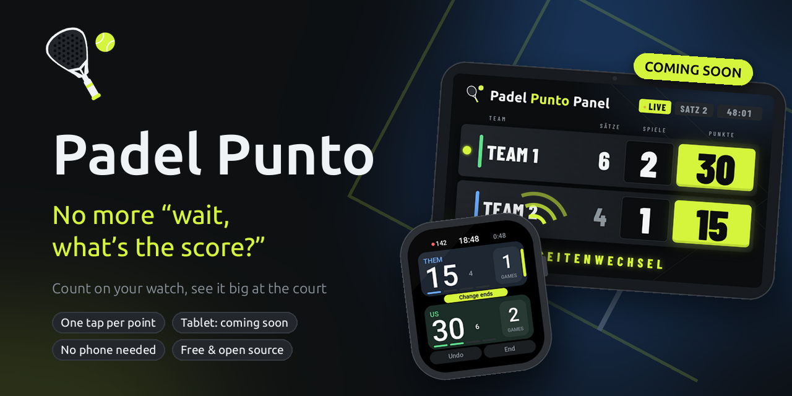
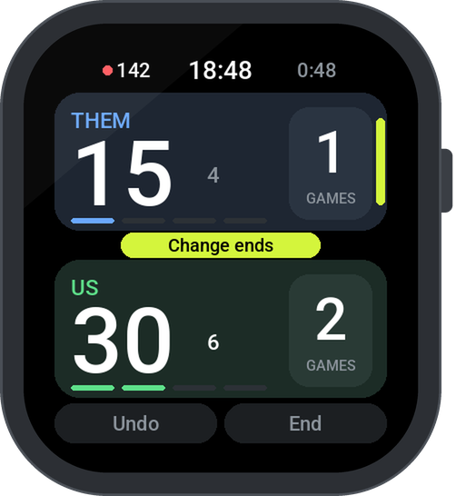
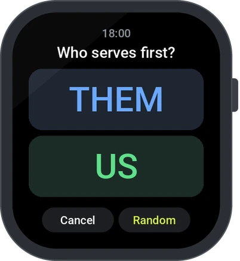
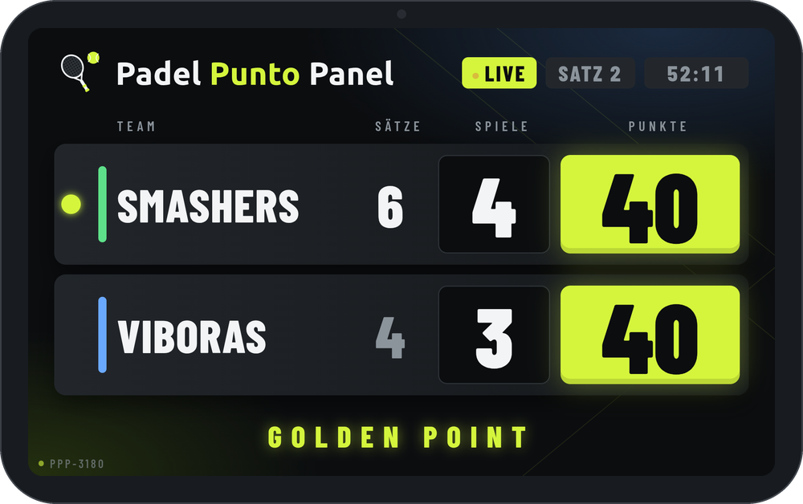

<p align="center">
  
</p>

<h3 align="center">
  Free padel apps that work together:<br>
  the watch keeps the score, the tablet at the court shows it to everyone.
</h3>

<br>

## 🎾 How it works

```
   ⌚ Watch                    📡 Bluetooth LE                 📺 Tablet at the court
   counts every point   ──────────────────────────────▶   shows the score big
   (works on its own)          PadelPunto/protocol          (live, two designs)
```

**The watch counts, everything else shows.** If the tablet is gone, the watch simply carries on.
No phone, no internet, no account.

<table>
  <tr>
    <td align="center" width="33%"><br><sub><b>One tap per point</b> on the watch</sub></td>
    <td align="center" width="33%"><br><sub><b>Racket spin</b> picks who serves</sub></td>
    <td align="center" width="33%"><br><sub><b>Live on the tablet</b> – Arena design</sub></td>
  </tr>
</table>

## 📦 Repositories

| | Repository | What it is |
|---|---|---|
| ⌚ | **[watch-zepp](https://github.com/PadelPunto/watch-zepp)** | **Padel Punto** for Amazfit (Zepp OS): Bip 6, Active 2 (Square), Bip Max – counts, says the score out loud, buzzes at change of ends |
| 📱 | **[app-android](https://github.com/PadelPunto/app-android)** | **Padel Punto Panel** for Android: the tablet scoreboard at the court |
| 📡 | **[protocol](https://github.com/PadelPunto/protocol)** | The Bluetooth LE protocol every Padel Punto device speaks |

## 🗺️ What’s next

- ⌚ **More watches** – `watch-wearos`, `watch-garmin`, …
- 🔘 **A clicker** at the court – `clicker-…`
- 📱 **More on Android** – `app-android` grows beyond the tablet

Every new device gets its own repository and speaks the same [protocol](https://github.com/PadelPunto/protocol).

---

<p align="center">
  <sub>Made with ☕ by Toni &amp; Claude AI · Free &amp; open source (GPL-3.0)</sub>
</p>
